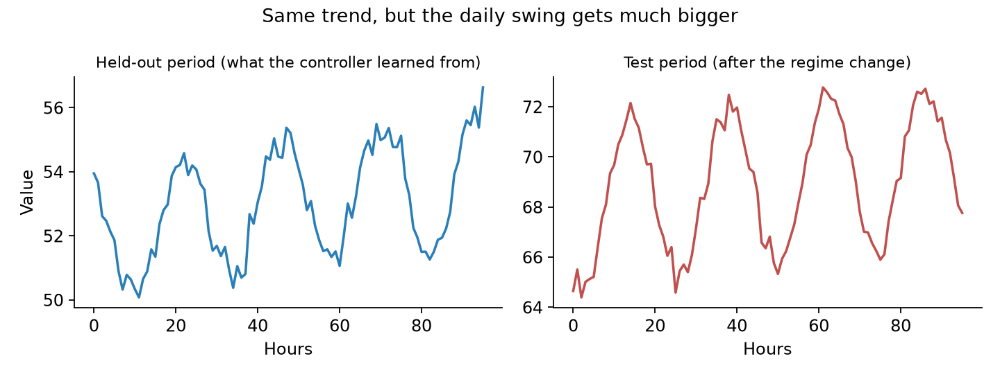
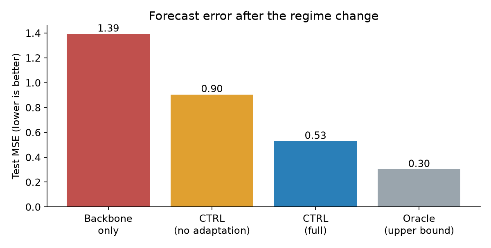
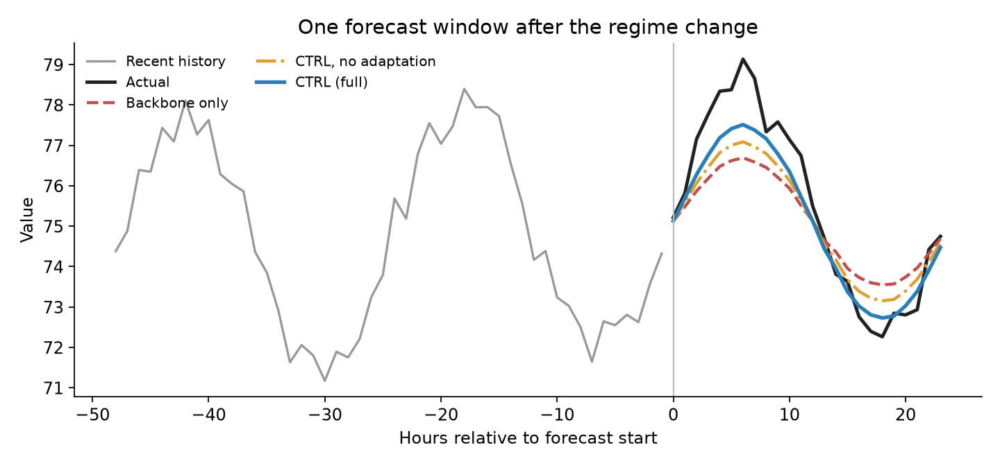

# Let the LLM Be the Coach, Not the Player: A Look at CTRL for Time Series Forecasting

*A plain-English tour of "CTRL: Control-Based Time Series Forecasting with LLM-Guided Residual Learning" (Kim et al., 2026)*

---

## The short version

Researchers have increasingly found that large language models (LLMs) are good at *reasoning* but unreliable at precise *arithmetic*. Yet most attempts to use them for forecasting ask them to do the arithmetic anyway: read in numbers, spit out numbers.

CTRL, a new approach from a team at Yonsei University, takes a different route. A conventional forecasting model still produces the numbers. The LLM plays **coach**: it studies how the forecasting model has been going wrong and issues a short list of instructions, such as "you're flattening the daily cycle, push it out by about 40%." A very small model then turns those instructions into a correction.

According to the authors, the result is a forecast that adapts better when the world changes, at a fraction of the cost of other LLM-based approaches.

> **A note on evidence.** All benchmark numbers quoted below are the authors' own, reported in the paper. I have not independently reproduced them: the authors' linked code repository currently contains only a placeholder README. The toy example in section 4 is my own simplified illustration, not a replication.

In this post we'll look at where LLM-based forecasters struggle, how CTRL works, and a toy example you can run yourself.

---

## 1. LLMs meet time series

Forecasting, whether it's electricity demand, store inventory, or financial prices, is about using the past to anticipate the future. Language models have shown up in forecasting in roughly three flavors:

- **"Forecasting as text completion."** Write the numbers out as text (`"12.1, 12.4, 12.9, ..."`) and ask the model to continue the sequence. (LLMTime, PromptCast.)
- **"Repurposing the LLM's machinery."** Translate the series into a form a pretrained language model understands, then lightly fine-tune it. (Time-LLM, GPT4TS.)
- **"Aligning numbers with language."** Build extra structure so time-series patterns and text-like representations line up. Often this includes splitting a series into trend, seasonality, and leftover noise. (TEMPO, CALF, TimeCMA.)

The appeal is intuitive. LLMs have absorbed a huge amount of knowledge about how the world works, and they can reason about *why* something might be happening. Maybe that helps forecasting.

## 2. Where LLM-based forecasters fall short

The paper's authors argue that most LLM-based approaches share two problems.

**They use the LLM for the thing it is weakest at.** Predicting the next number precisely is a job that purpose-built forecasting models already do very well. Studies the paper cites, such as Tan et al. (2024), "Are Language Models Actually Useful for Time Series Forecasting?", and Park et al. (2025), find that an LLM's real value lies in reasoning about a series rather than producing exact values, and that LLM forecasts can be fragile: small amounts of noise can throw them off.

**They tie the LLM directly to the forecast.** When the LLM's output *is* the prediction, any wobble in the LLM shows up in the forecast. The authors say this is most damaging when the data is **non-stationary**, meaning its underlying behavior is shifting: a new trend, a change in seasonal swing, a regime change. They also characterize alignment-style methods as assuming that the future looks like the training data, which is the authors' reading of those methods rather than something every one of them states.

A fair note here: shifting data is not a new problem. Econometricians have long had tools for it, such as differencing and models that allow for structural breaks. The claim is narrower: LLM-based and alignment methods don't handle it well, and CTRL tries to fix that.

### The practical costs

| Approach | Practical burden (from the paper's setup) |
|---|---|
| Prompt-only (e.g. LLMTime) | One LLM call *per forecast*. Expensive at scale. |
| Fine-tuned alignment methods (CALF, TEMPO) | 12 to 18 million trainable parameters and roughly 1 to 2 hours of training. |

### How the camps compare

How do LLM-based forecasters stack up against classical statistical (econometric) models and time series foundation models (TSFMs, such as Google's TimesFM, which are pretrained on huge collections of series and forecast "zero-shot")? The table gives the general tendencies as commonly understood. These are not measured in the paper, so treat them as rules of thumb, not findings.

| | Classical statistical models (ARIMA, exponential smoothing) | Time series foundation models (TSFMs) | LLM-based forecasters |
|---|---|---|---|
| **Cost to run** | Very low | Moderate (large model, one pass per forecast) | Highest (large model, and for prompt-only methods, a call per forecast) |
| **Numerical precision** | Commonly strong on stable, well-behaved series | Strong | Weakest of the three, per the studies above |
| **Transparency** | High: you can inspect the components | Low | Low, though LLMs can explain themselves in words |
| **Handling change** | Needs re-fitting, but has formal tools for breaks | Fixed once pretrained | Fragile under shift, per the authors |
| **Use of outside context (text, events)** | None without extra work | Limited | **Strongest**: can read and reason about text |

The pattern is the point. LLMs win on exactly one row, the ability to use context and reason in words, and that is precisely the row CTRL builds on, while keeping the numerical work with a model that is good at it.

To be upfront: the paper benchmarks against deep-learning and LLM-based models only. It does not test classical statistical models, and it leaves TSFMs like TimesFM for future work.

## 3. Meet CTRL

The name stands for **C**ontrol-based **T**ime series forecasting with LLM-guided **R**esidual **L**earning. The core idea fits in one line:

> **Final forecast = backbone forecast + a learned correction, where an LLM decides what kind of correction is needed.**

A few terms you'll see below. A **frozen** model is one that has been trained and is then left alone. A **residual** is the leftover error between a forecast and what actually happened. **Held-out data** is data set aside during training, which makes it a fair place to measure how a model's forecasts go wrong. And a time series can be split into three ingredients: the **trend** (the long-run direction), the **seasonal** pattern (the repeating daily or weekly cycle), and the **irregular** part (the noisy leftovers).

Here is the cast of characters.

**The backbone (frozen).** An ordinary forecasting model, trained once and then left alone. The paper tests two: DLinear and PatchTST. This is the "player." It does the numbers.

**The controllers (LLM agents).** Three LLM "specialists," one for each ingredient of a time series:

- a **Trend agent** (is the backbone getting the direction and slope right?),
- a **Seasonal agent** (is it flattening the daily or weekly cycle?),
- an **Irregular agent** (how noisy or surprising is what's left over?).

They study the backbone's *past mistakes* on held-out data. Importantly, they never see the raw series, only summaries such as "the backbone underestimates trend slope by 15%." The paper argues this also sidesteps the worry that an LLM has memorized the benchmark data.

**The control signals.** Each numerical agent hands back four numbers:

| Signal | Plain-English meaning |
|---|---|
| **scale** | Should this component be turned up or down? |
| **bias** | Is the forecast systematically too high or too low? |
| **gate** | How aggressively should the correction be applied? |
| **confidence** | How sure is the agent? |

The Irregular agent writes a short natural-language note instead, which gets converted into numbers by a frozen text encoder (a small language model, GPT-2).

**The residual decoder.** A tiny neural network (about 400,000 parameters) that reads the control signals and produces the actual numerical correction. It is the *only* part that gets trained, and it trains in under two minutes.

**Test-time adaptation.** This is the clever part for a changing world. As new data comes in, CTRL periodically compares simple statistics of the incoming inputs (for example, how strong the seasonal swing looks) against what it saw during setup. If something has moved by more than about two standard deviations, the LLM is asked again and the control signals are adjusted. No true future values are needed for this, which matters because in real deployments the answers arrive late or never. Because the signals are cached and shared, the whole system needs only **3 to 24 LLM calls in total**, not one per forecast.

```
 SETUP (once)
   held-out data ──► backbone's past mistakes ──► LLM controllers ──► control signals
                                                  (Trend / Seasonal /        │
                                                   Irregular)                │
                                                        ▲                    │
   LIVE FORECASTING                                     │ re-asked only if   │
                                                        │ inputs shift       ▼
   new history ──► frozen backbone ──► base forecast ──► residual decoder ──► + ──► final forecast
        │                                                       (correction)
        └──► shift check (input statistics only, no answers needed) ──┘
```

### What the paper found

- **Best gains where data shifts.** On the datasets with the biggest change between training and test (ETTh2 and ETTm2, which record electricity-transformer temperatures), CTRL cut error (MSE) by up to about **12%** relative to its backbone, according to the authors' text. Their own results table shows larger reductions at some horizons (for example, about 23% on ETTh2 at the longest horizon with the DLinear backbone), so that figure may be conservative or may be an inconsistency in the paper. The authors also say gains shrink at long horizons, which sits uneasily with that table row.
- **Competitive elsewhere.** On stable data, gains are small, and on the Weather dataset the fine-tuned CALF model actually did better at some horizons. The authors describe this as expected: with little shift, there is little to adapt to.
- **Beats "LLM as predictor," in one comparison.** Against LLMTime (GPT-4 forecasting directly), CTRL's MSE was **19.6% to 44.3% lower**. That comparison covers two datasets and one backbone, so I wouldn't generalize from it.
- **Much lighter to train.** About 0.4M trainable parameters, versus 12.4M for TEMPO and 18.2M for CALF, and under 2 minutes of training versus roughly 1 to 2 hours. That's the *training* cost, though. CTRL still needs a pretrained backbone, a frozen 124M-parameter text encoder, and access to a capable LLM (the paper uses Llama 3.3 70B) for its handful of calls.
- **The LLM's input helps, but modestly.** When the authors swapped in random numbers or random text for the real control signals, performance fell back to roughly the level of having no signal at all. Even with no signal, the decoder alone still improved about 4% on ETTh2, versus about 13% for full CTRL. And a plain learned (non-LLM) way of producing the signals was only about 3% to 4% worse in MSE than the LLM version. So the LLM adds real value, but it is not the whole story.

### Caveats

The authors note that improvements shrink at long forecast horizons, where the backbone's errors are larger and corrections are less certain. CTRL has not yet been tried as a correction layer on top of foundation models like TimesFM. Beyond what the authors say, all the evidence comes from standard academic benchmark datasets rather than a real deployment, and the method depends on having access to a capable LLM.

## 4. A toy example

To make this concrete, I built a small simulation that mimics CTRL's flow. The code is in [`toy_ctrl.py`](toy_ctrl.py). It needs Python with numpy, statsmodels and matplotlib, and runs in about ten seconds (`python toy_ctrl.py`).

> **Important honesty note.** I did not call a real LLM. The "controller" in this toy is a simple rule-based stand-in: it reads the same kind of summary an LLM agent would, then works out the four signals with basic arithmetic. The script prints the text an LLM would have been shown. So this toy illustrates the *plumbing and logic* of CTRL. It is not a reproduction of the paper's results, and it says nothing about how a real LLM would perform. I also built the backbone with a deliberate flaw for CTRL to fix, which makes the toy favorable by construction.

**The setup.** A synthetic hourly series with a steady upward trend and a daily cycle. Training and held-out periods look the same. Then, in the test period, there is a regime change: **the daily swing gets 60% bigger** while the trend stays put.



**The backbone.** A frozen model that learned the average daily shape from the training data, but, like many smooth models, flattens it by 20% and under-extrapolates the trend.

**Step 1: the controller reviews the mistakes.** Looking at the held-out period, the controller is shown, in effect: *"the backbone's seasonal amplitude was 1.57 versus an actual 1.97; its trend slope was 0.005 versus an actual 0.016."* (The units are just the toy's.) It issues signals along the lines of *seasonal: scale up ×1.25, gate 0.6, confidence 0.8*, and a similar trend signal that hits the allowed maximum of 1.5.

**Step 2: the decoder learns to apply it.** The tiny decoder learns how much weight to give those instructions, using the held-out data.

**Step 3: the world changes.** At test time, CTRL checks the input statistics. The **trend shift score is about 0.0**, since nothing changed there. The **seasonal shift score is about 19**, far above the threshold of 2. So only the seasonal signal is reconsidered: its scale is pushed to the maximum, more authority is handed to the decoder, and confidence is lowered. The trend signal is left alone. This mirrors the component-by-component adaptation in the paper.

**The results on the test period.** Error is measured as MSE (mean squared error), and lower is better. I added an "oracle" row, which peeks at the test answers to find the best possible re-scaling of the two components. It's an unfair ceiling, not a real method.



| Model | Test MSE | Change vs. backbone |
|---|---|---|
| Backbone only | 1.39 | n/a |
| CTRL, no adaptation | 0.90 | −35% |
| CTRL, full (with adaptation) | 0.53 | −62% |
| Oracle (upper bound, peeks at answers) | 0.30 | −78% |

That is one simulated series. Rerunning with 20 different random seeds gives the same picture: no adaptation improves on the backbone by 34% on average (range 30% to 38%), full CTRL by 61% (59% to 63%), and the oracle by 78%. Full CTRL beat the no-adaptation version in all 20 runs. The seasonal shift score averaged about 18 across seeds, and the trend score stayed below 0.3.

And here is what it looks like on a single 24-hour forecast:



The backbone (red dashed) draws too gentle a daily cycle. The CTRL versions (orange and blue) stretch it toward the truth (black). They still fall short of the real peak, because the controller's scale is capped at 1.5, a limit the paper also uses.

**What to take from the toy:**

1. **The plumbing works.** Read the backbone's past mistakes, boil them down to a few compact signals, apply a small learned correction, and re-check when the inputs shift. That loop is the heart of CTRL.
2. **Shift detection is targeted.** It flagged the component that changed (seasonal) and left the other alone.
3. **Adaptation mattered a lot here, and shouldn't be compared with the paper.** I made the shift large and abrupt, so the check fires clearly. In the paper, adaptation's average contribution is small (about 0.7%) and shows up mainly on the hardest samples.
4. **What the toy can't tell you.** The stand-in controller does simple arithmetic on held-out ratios, so any basic recalibration rule would do the same. Whether a real LLM produces signals this good is exactly the open question, and the paper's own ablation suggests the LLM's edge over a plain learned alternative is modest (about 3% to 4%).
5. **There is a ceiling.** Even the best case here leaves room: capped signals recover most but not all of what an unconstrained oracle could.

If you'd like to go one step further, the stand-in `controller()` and `adapt_controller()` functions in the script are the natural places to swap in real LLM calls. Set the `SEED` environment variable to try other random seeds.

## 5. Takeaways

- LLMs are strongest as **reasoners**, not calculators. CTRL is built around that observation.
- Splitting the job (a stable model for numbers, an LLM for diagnosis, a tiny decoder for the correction) makes the system **cheap, interpretable, and robust** to change.
- It is most useful when **your data drifts** and labels arrive late. It offers little when your data is very stable.
- Open questions remain, including how it behaves on top of foundation models and how it compares with classical statistical baselines, since the paper doesn't test either.

---

**Reference:** Kim, M., Ji, D., Lee, Y., Kim, B., & Jang, B. (2026). *CTRL: Control-Based Time Series Forecasting with LLM-Guided Residual Learning.* arXiv:2609.23257. Code repository (announced by the authors, but as of late September 2026 it contains only a placeholder README and no code): https://github.com/mfriendly/CTRL
